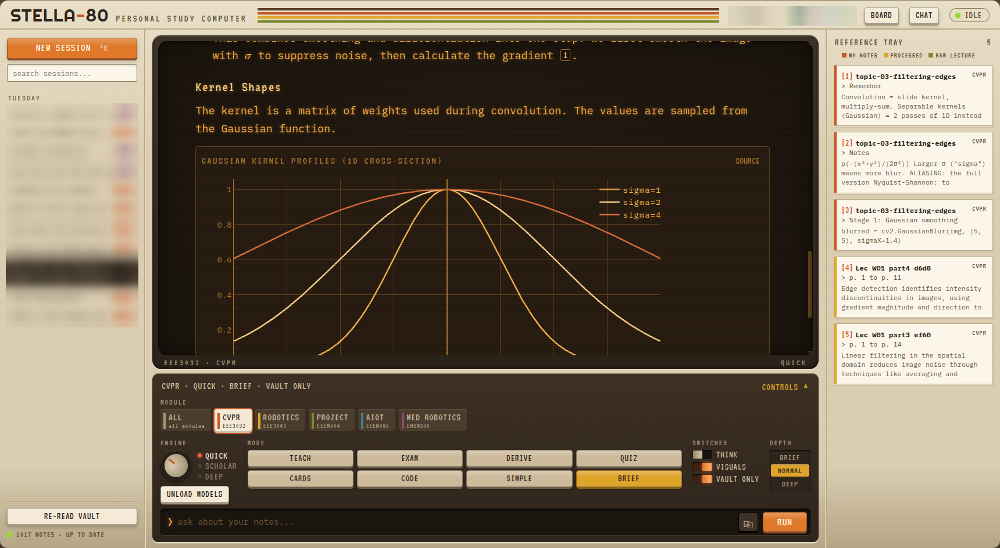

# STELLA-80

**A personal study computer that has read all your lecture notes.**
It runs on your own machine, with no cloud, no API keys and no telemetry.

<!-- Add screenshots before publishing: docs/screenshots/terminal.png (main screen), board.png, obsidian-graph.png

-->

STELLA-80 has two halves:

1. **The vault agent** reads your course files in the background. That means PDFs, slides, Word documents,
   notebooks, spreadsheets, code and images. It turns them into an **Obsidian knowledge graph** with concept notes,
   per-course concept maps and links that bridge courses. A vision model reads the slide images too.
2. **The study terminal** is a web UI made to feel like a piece of 80s hardware. It answers from *your* notes and
   cites every claim back to the exact slide or page.

Everything runs on local models through [Ollama](https://ollama.com). The whole thing was built and is used daily
on a single mini PC, a Ryzen with a Radeon 780M iGPU, serving one student and three friends.

## What makes it different

**It knows your course, not the internet's version of it.**
- Search combines keyword matching (BM25) with embeddings over your own notes. Every answer cites its sources
  as [1], [2], and you can open the note behind each one.
- Flip the **VAULT ONLY** switch and the tutor answers only from your material. If something isn't there, it says so.
- In normal mode, anything the tutor adds beyond your notes is marked *(general)*. Where your lecturer's notation
  differs from the textbook, it follows your lecturer's.

**The knowledge graph is built carefully.**
- Every concept the model extracts has to come with a quote from the source. The agent checks that quote against the
  original text and drops the concept if it doesn't match.
- Duplicate concepts are merged by embedding similarity and by aliases you control in `rules.yaml`
  (for example SIFT, *Scale-invariant feature transform*).
- Every file also gets a `_raw/` copy of its text with no AI involved, so you can always check what the model saw.
- **The agent never edits your own notes.** Generated notes keep anything you add below a marker line.
- The vault is a git repository, with a commit after every run.

**It is built for small hardware.**
- A RAM guard checks free memory before loading a big model, and falls back to the small one with a notice.
- Questions go through a queue so that one answer runs at a time. Everyone else sees their place in line.
- The agent throttles itself by load average, pauses between calls and releases the vision model when it is done.
- Daily study summaries are only written when the machine is idle.

**There are study modes, not just a chat box.**

| Mode | What you get |
|---|---|
| TEACH | Intuition, then the formal definition and maths, a worked example and common pitfalls |
| EXAM | The answer a top-mark exam script would give |
| DERIVE | Numbered steps, naming the rule used at each one |
| QUIZ | Five questions of rising difficulty, with answers hidden until you open them |
| CARDS | Flip-card revision decks |
| CODE | One minimal runnable script that demonstrates the idea |
| SIMPLE | An explanation with an everyday analogy first |
| BRIEF | Five lines, no preamble |

Answers can include LaTeX, interactive function plots and 3D surfaces (Plotly), and Mermaid diagrams. You can also
paste a screenshot of a slide and ask about it. Eight tutor personas are built in, from *Socratic coach* to
*Strict teacher*, or you can write your own instructions.

**It has a personality.**
The UI has amber, green, paper and OLED themes, engine knobs and rocker switches, and a "reasoning tape" that shows
the model thinking. Answers are rendered like good handwritten study notes, without emoji or "Great question!".

## Two ways to run it

| | **Solo** | **Shared** |
|---|---|---|
| For | You, on your laptop or desktop | A mini PC or home server that you and your friends use |
| Login | None. It only listens on `127.0.0.1` and refuses to start otherwise | A personal passphrase per person, rate-limited |
| Extras | | Group chat, a leaderboard with streaks, a study log, an admin console to add and remove people and set per-person limits (engines, THINK, daily question cap, uploads), uploads to the processing queue |
| Access | `http://127.0.0.1:8480` | Over Tailscale (recommended) or behind a reverse proxy with HTTPS |

Each mode can be installed with **Docker Compose** or **bare metal** (a Python venv plus systemd user services).
See [docs/INSTALL.md](docs/INSTALL.md).

```bash
git clone https://github.com/023b/stella80 && cd stella80
scripts/init.sh solo --sample        # or: shared
docker compose up -d
docker compose exec ollama ollama pull nomic-embed-text
docker compose exec ollama ollama pull qwen3.5:4b
# open http://127.0.0.1:8480
```

## How it fits together

```
 lecture files ──► vault agent ──► Obsidian vault ◄── you, in Obsidian
 (pdf, pptx,        (Ollama:        _auto/  concepts, sources, maps
  docx, ipynb,       text + vision  _raw/   untouched text
  csv, images)       models)        your own notes (never edited)
                                          │
                                          ▼
                         STELLA-80 web app: index (FTS5 + embeddings)
                         ──► retrieval ──► Ollama ──► cited, streamed answer
```

## Hardware

Everything runs through Ollama, so any model works. Pick models that fit your machine (`engines:` in
`stella80.yaml`, `chat_model` and `vision_model` in the agent config).

| Machine | QUICK | SCHOLAR | DEEP and agent |
|---|---|---|---|
| 8 GB RAM | qwen3.5:4b | qwen3.5:4b | qwen3:8b |
| 16 GB RAM | qwen3.5:4b | gemma3:12b | qwen3:8b |
| 32 GB, or a GPU with 16 GB or more (tested) | qwen3.5:4b | gemma4:26b-a4b-it-qat | qwen3:30b-a3b |

On the tested mini PC, a Radeon 780M through Vulkan gives about 13 to 14 tokens per second for QUICK and SCHOLAR.
DEEP on the CPU gives about 10. That machine runs two Ollama instances, one on the iGPU for answers and one on
the CPU for the agent, and both URLs can be set in the config.

## Privacy and security

- **Nothing leaves your machine.** Every JavaScript library and font is bundled with the app, with no CDN calls.
  Models run in your own Ollama.
- In shared mode, passphrases are stored as scrypt hashes and sessions are signed cookies. Each person only sees
  their own vault and their own questions. The leaderboard shows time, counts and topics, and anyone can hide
  their topics and summary.
- Shared mode has no TLS of its own. Keep it on Tailscale or a LAN, or put Caddy or nginx in front for HTTPS.
  Don't forward it to the open internet as plain HTTP.

## Limitations

- Answer quality depends on the model you run. Small models cite well but reason less well.
- The first pass over a big course takes hours on a CPU. After that, only new or changed files are read.
- Tested on Linux. macOS should work with Docker. Windows is untested.

## Repository layout

```
stella80/        web app (FastAPI, SQLite FTS5, vanilla JS), manage.py for accounts
agent/           vault agent and rules.yaml
deploy/systemd/  user units for bare metal
scripts/         init.sh, install-systemd.sh
docs/            INSTALL.md, VAULT-AGENT.md
examples/        a sample lecture to try it with
```

## Licence

MIT. Bundled third-party libraries and fonts keep their own licences; see [THIRD_PARTY.md](THIRD_PARTY.md).
